# -Nigerian-Real-Estate-Market-Analysis-Dashboard-2021---2025
A Power BI data analysis project following a 15-step workflow

- **Author:** Hamzat Victor Chisom
- **Tools:** Power BI (Power Query, data modelling, DAX, visuals)
- **Date:** November 2026

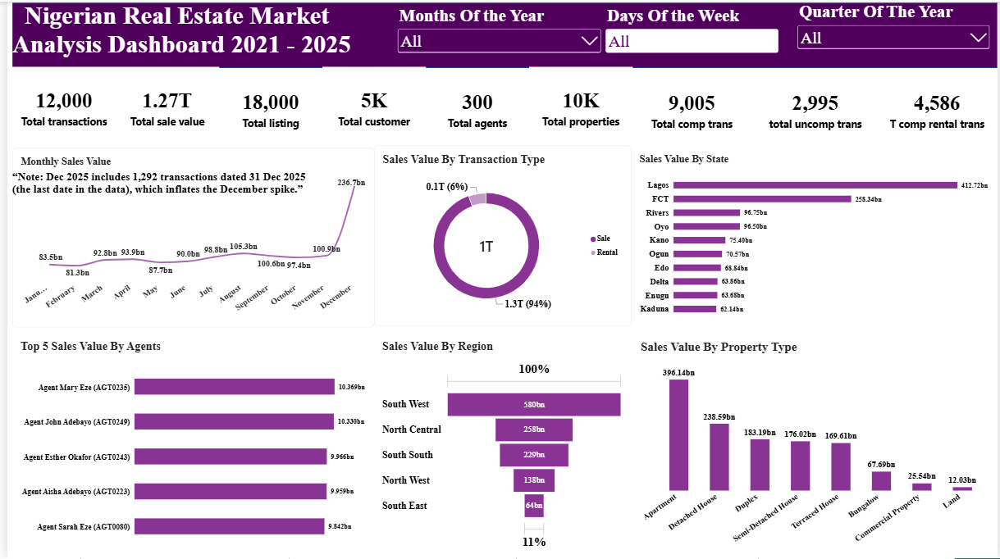

## 1. Project Overview

This project turns raw Nigerian real estate data into business intelligence. A five-page Power BI dashboard shows how the market performs across time, locations, property types, customers and agents, so that a real estate company can decide where to focus, what to sell or rent, and who to target.

The project follows a 15-step data analysis workflow, from defining the business objective to monitoring:

1. Understand the business objective
2. Agree clear objectives
3. Define business and analytical questions
4. Data collection
5. Import data
6. Understand the data
7. Data cleaning and data quality
8. Data modelling
9. Feature engineering
10. EDA and key metrics (KPIs)
11. Visualize
12. Interpretation and communication
13. Action and recommendation
14. Documentation
15. Monitor

### Project at a glance

| Item | Detail |
|------|--------|
| Data | 7 CSV tables (2 fact tables, 5 dimension tables), covering 2021 to 2025 |
| Records | 12,000 transactions, 18,000 listings, 10,025 properties, 5,020 customers, 300 agents |
| Output | Five-page interactive Power BI dashboard |
| Headline result | 1.27 trillion naira of completed sales value |

## 2. Business Objective and Key Questions

*Steps 1 to 3: business objective, clear objectives, analytical questions.*

### Business objective

To analyse Nigerian real estate listing and transaction data in order to understand how the market is performing, how business activity changes over time, and which locations, property types, customers and agents generate the most value. The analysis supports data-driven decisions on where to focus, what to sell or rent, who to target, and how to manage agent performance.

### The overall question

> *"Where is the business activity, what is driving sales value, who should we target, and where should we focus?"*

### Analytical questions

| Theme | Questions |
|-------|-----------|
| Market performance | How many listings, transactions, properties, customers and agents are there? How many transactions are completed and how many cancelled? |
| Trends over time | How does sales value change by month, quarter and day of the week? |
| Sales and rentals | How is value split between sales and rentals, and how many rentals are completed? |
| Location performance | Which states, regions and cities generate the highest sales value? |
| Property performance | Which property types and furnishing statuses generate the most sales value? |
| Customer analysis | Which income segments, age groups, genders, occupations and marital statuses bring the most sales value? |
| Agent performance | Who are the top agents by sales value, and how does value differ by specialization? |
| Listing status | How are listings split by status and by type? |

## 3. Data Collection and Understanding

*Steps 4 and 6: data collection and understanding the data.*

The dataset is a star schema of seven CSV files: two fact tables that record events, and five dimension tables that describe them.

| Table | Type | Rows | Description |
|-------|------|------|-------------|
| fact listing | Fact | 18,000 | Property listings for sale or rent, with asking price and days on market |
| fact transaction | Fact | 12,000 | Sales and rentals, with amount, annual rent and commission |
| dim property | Dimension | 10,025 | Property type, bedrooms, bathrooms, size, year built, furnishing |
| dim customer | Dimension | 5,020 | Demographics, occupation, income segment, home location |
| dim agent | Dimension | 300 | Agent profile, specialization, years of experience |
| dim location | Dimension | 34 | City, state and region |
| dim date | Dimension | 1,826 | Calendar table covering 2021 to 2025 |

### Data dictionary

**dim location**

| Field | Type | Key | Description |
|-------|------|-----|-------------|
| location_id | Text | PK | Unique identifier for each location |
| city | Text | - | City or locality where the property is located |
| state | Text | - | Nigerian states |
| region | Text | - | Broad Nigerian geographic region |
| active location | Integer | - | Whether the location is active in the dataset |

**dim date**

| Field | Type | Key | Description |
|-------|------|-----|-------------|
| date_id | Integer | PK | Date in YYYYMMDD format |
| date | Date | - | Calendar date |
| year | Integer | - | Calendar year |
| quarter | Text | - | Quarter of the year (Q1 to Q4) |
| month number | Integer | - | Month number, 1 to 12 |
| month name | Text | - | Name of the month |
| month year | Text | - | Month and year, e.g. Jan-2024 |
| week number | Integer | - | ISO week number |
| day | Integer | - | Day of the month |
| day name | Text | - | Name of the day |
| is weekend | Boolean | - | Whether the date falls on a weekend |

**dim property**

| Field | Type | Key | Description |
|-------|------|-----|-------------|
| property_id | Text | PK | Unique identifier for each property |
| location_id | Text | FK | Location of the property |
| property type | Text | - | Type of property |
| bedrooms | Integer | - | Number of bedrooms |
| bathrooms | Integer | - | Number of bathrooms |
| property_size_sqm | Decimal | - | Size in square meters |
| year built | Integer | - | Year of construction |
| furnishing status | Text | - | Furnishing condition |

**dim customer**

| Field | Type | Key | Description |
|-------|------|-----|-------------|
| customer | Text | PK | Unique identifier for each customer |
| first name | Text | - | First name |
| last name | Text | - | Surname |
| gender | Text | - | Gender |
| age | Integer | - | Age |
| marital status | Text | - | Marital status |
| occupation | Text | - | Occupation |
| income segment | Text | - | Broad income classification |
| home_location_id | Text | FK | Location of the customer's home |

**dim agent**

| Field | Type | Key | Description |
|-------|------|-----|-------------|
| agent_id | Text | PK | Unique identifier for each agent |
| agent name | Text | - | Name assigned to the agent |
| gender | Text | - | Gender |
| age | Integer | - | Age |
| base_location_id | Text | FK | Agent's primary operating location |
| specialization | Text | - | Primary area of specialization |
| years experience | Integer | - | Years in real estate |

**fact listing**

| Field | Type | Key | Description |
|-------|------|-----|-------------|
| listing_id | Text | PK | Unique identifier for each listing |
| property_id | Text | FK | Property listed |
| agent_id | Text | FK | Agent responsible |
| date_id | Integer | FK | Link to the date table |
| listing date | Date | - | Date the property was listed |
| listing type | Text | - | For sale or for rent |
| listing status | Text | - | Status of the listing |
| asking price | Decimal | - | Price requested |
| days_on_market | Integer | - | Days the property stayed on the market |

**fact transaction**

| Field | Type | Key | Description |
|-------|------|-----|-------------|
| transaction_id | Text | PK | Unique identifier for each transaction |
| listing_id | Text | FK | Listing behind the transaction |
| property_id | Text | FK | Property involved |
| customer_id | Text | FK | Customer involved |
| agent_id | Text | FK | Agent responsible |
| date_id | Integer | FK | Link to the date table |
| transaction date | Date | - | Date of the transaction |
| transaction type | Text | - | Sale or rental |
| transaction status | Text | - | Completed or cancelled |
| transaction amount | Decimal | - | Financial value of the transaction |
| annual rent | Decimal | - | Annual rent (rental transactions) |
| commission_rate | Decimal | - | Commission percentage |
| commission_amount | Decimal | - | Commission value |

### What the data checks showed

- Every table has a unique primary key and the key columns have no empty values.
- Agent names repeat: the 300 agents share only 184 distinct names. The agents are different people (they differ in age, gender, location and experience), so agent_id is the true identifier.
- 121 properties (1.2%) have no recorded size, 80 have no furnishing status, and 100 customers have no occupation.
- 1,292 transactions (10.8%) are dated 31 December 2025, which is the last date in the data.

## 4. Data Import and Cleaning

*Steps 5 and 7: import data, data cleaning and data quality.*

All seven CSV files were loaded into Power BI with Get Data and cleaned in Power Query. Each table has the same base steps; two tables have an extra step.

| Table | Applied steps |
|-------|---------------|
| dim agent | Source > Promoted Headers > Changed Type > Removed Duplicates (agent_id) |
| dim customer | Source > Promoted Headers > Changed Type > Removed Duplicates > Replaced Value (blank occupation to "Not Specified") |
| dim date | Source > Promoted Headers > Changed Type > Removed Duplicates (date_id) |
| dim location | Source > Promoted Headers > Changed Type > Removed Duplicates (location_id) |
| dim property | Source > Promoted Headers > Changed Type > Removed Duplicates > Replaced Value (blank furnishing status to "Not Specified") |
| fact listing | Source > Promoted Headers > Changed Type > Removed Duplicates (listing_id) |
| fact transaction | Source > Promoted Headers > Changed Type > Removed Duplicates (transaction_id) |

### Data quality decisions

- Headers were promoted and data types set on every table.
- Duplicates were removed on each table's primary key. In the tables I checked, the row counts did not change, so this step acted as a safeguard.
- Blank text values were replaced with "Not Specified": 80 in furnishing_status and 100 in occupation. They now appear as a category in charts instead of blanks.
- The 121 blank property_size_sqm values were left null on purpose. Filling them with an average would invent sizes, and they are excluded from price-per-sqm calculations. They are spread across all property types, so they are random gaps, not a special kind of property.

### Power Query screenshots (Applied Steps pane for each of the 7 tables)

**dim_agent**

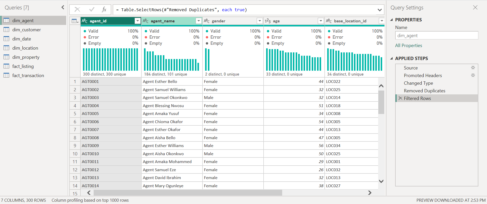

**dim_customer**

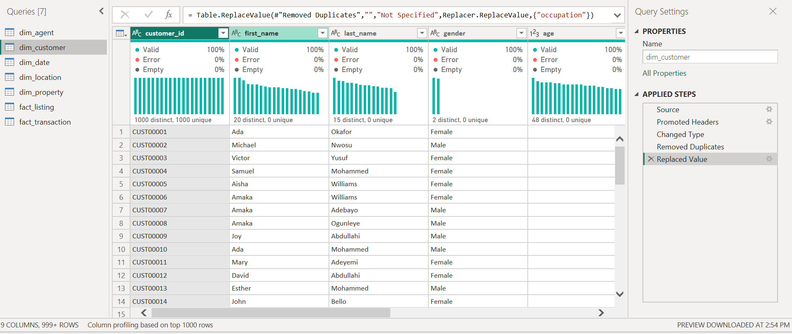

**dim_date**

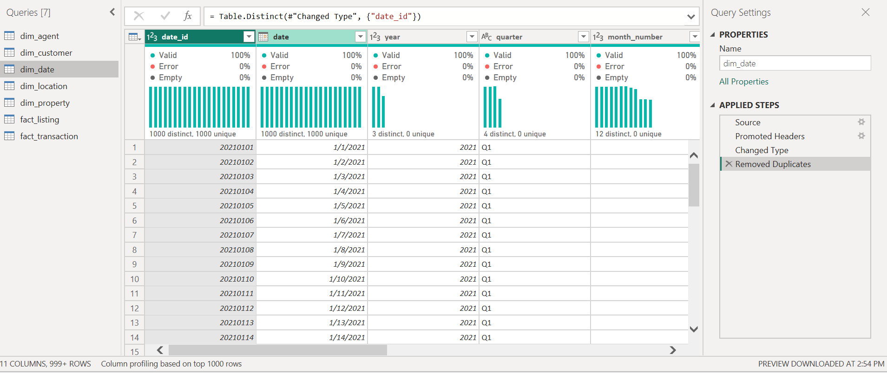

**dim_location**

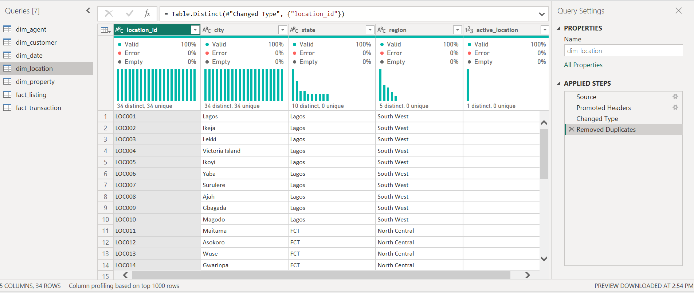

**dim_property**

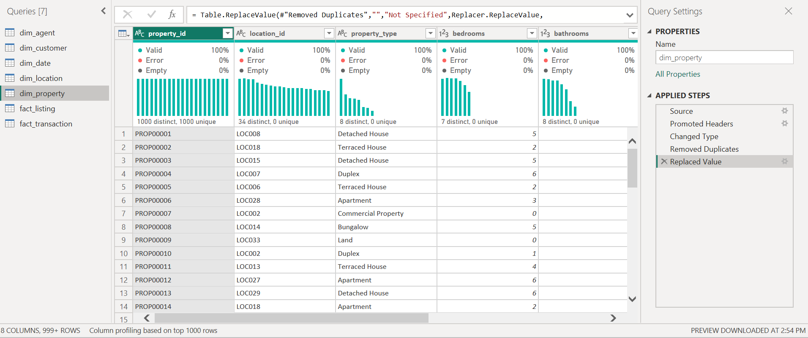

**fact_listing**

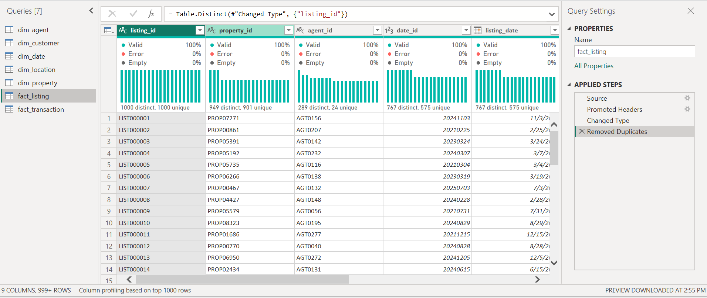

**fact_transaction**

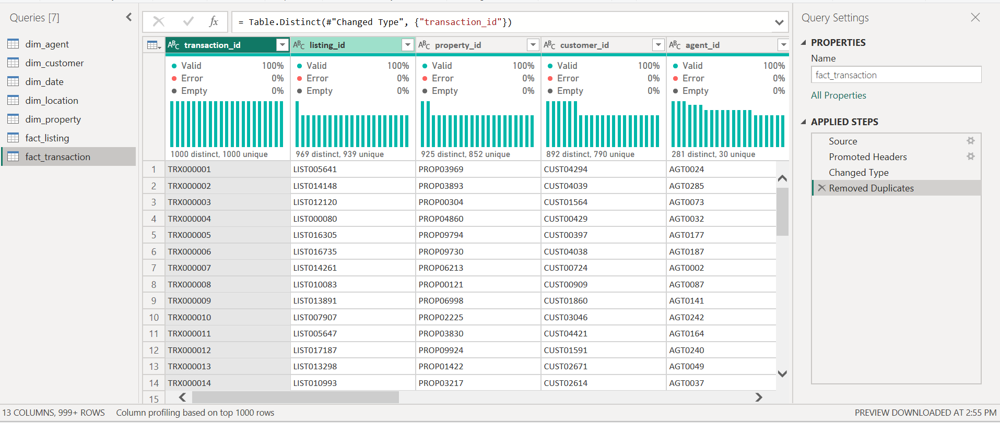

## 5. Data Modelling

*Step 8: tables, relationships, keys, fact and dimension tables.*

The model is a star schema. The two fact tables (fact listing and fact transaction) are surrounded by five dimension tables. All relationships are one-to-many, with the "one" side on the dimension.

| Dimension (one) | Fact or table (many) | Key |
|-----------------|----------------------|-----|
| dim location | dim property | location_id |
| dim property | fact listing, fact transaction | property_id |
| dim agent | fact listing, fact transaction | agent_id |
| dim date | fact listing, fact transaction | date_id |
| dim customer | fact transaction | customer_id |

### Modelling decisions

- dim customer[home_location_id] (where a customer lives) and dim agent[base_location_id] (where an agent works) are not linked to dim location. They describe different things from a property's location, and linking them would create ambiguous relationships.
- fact listing and fact transaction are not linked to each other. Both connect through the shared dimensions. As a result, listing fields cannot filter transaction values, so the listing charts use counts of listings.

**Model view screenshot showing all 7 tables and their relationships**

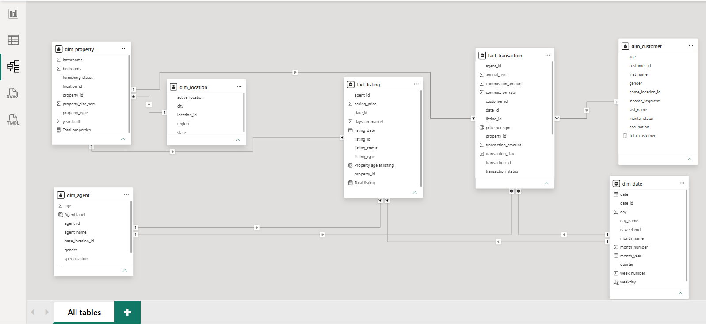

## 6. Feature Engineering

*Step 9: calculated columns, ratios, date parts, labels and DAX measures.*

Feature engineering added 4 calculated columns (row-level fields) and 11 DAX measures (calculations that respond to filters and slicers).

### Calculated columns

**Property age at listing** (fact listing): Age of the property when it was listed

```DAX
Property age at listing = YEAR(fact_listing[listing_date].[Date]) - RELATED(dim_property[year_built])
```

**price per sqm** (fact transaction): Transaction value per square metre

```DAX
price per sqm = DIVIDE(fact_transaction[transaction_amount], RELATED(dim_property[property_size_sqm]))
```

**weekday** (dim date): Day-of-week number

```DAX
weekday = WEEKDAY(dim_date[date].[Date])
```

**Agent label** (dim agent): Unique label for each agent, because names repeat

```DAX
Agent label = dim_agent[agent_name] & " (" & dim_agent[agent_id] & ")"
```

### Measures

**Total properties** (dim property): Number of properties

```DAX
Total properties = DISTINCTCOUNT(dim_property[property_id])
```

**Total listing** (fact listing): Number of listings

```DAX
Total listing = DISTINCTCOUNT(fact_listing[listing_id])
```

**Total customer** (dim customer): Customers on record

```DAX
Total customer = COUNT(dim_customer[customer_id])
```

**Total agents** (dim agent): Number of agents

```DAX
Total agents = COUNT(dim_agent[agent_id])
```

**Total transactions** (fact transaction): Number of transactions

```DAX
Total transactions = COUNT(fact_transaction[agent_id])
```

**Total comp trans** (fact transaction): Completed transactions

```DAX
Total comp trans = CALCULATE([Total transactions], fact_transaction[transaction_status] = "Completed")
```

**total uncomp trans** (fact transaction): Cancelled transactions

```DAX
total uncomp trans = CALCULATE([Total transactions], fact_transaction[transaction_status] = "Cancelled")
```

**T comp rental trans** (fact transaction): Completed rentals

```DAX
T comp rental trans = CALCULATE(COUNT(fact_transaction[transaction_id]), fact_transaction[transaction_status] = "Completed", fact_transaction[transaction_type] = "Rental")
```

**total completed sales transactions** (fact transaction): Completed sales

```DAX
total completed sales transactions = CALCULATE(COUNT(fact_transaction[transaction_id]), fact_transaction[transaction_status] = "Completed", fact_transaction[transaction_type] = "Sale")
```

**Total sale value** (fact transaction): Value of completed sales only

```DAX
Total sale value = CALCULATE(SUM(fact_transaction[transaction_amount]), fact_transaction[transaction_status] = "Completed", fact_transaction[transaction_type] = "Sale")
```

**Completed transaction value** (fact transaction): Value of all completed transactions, sales and rentals

```DAX
Completed transaction value = CALCULATE(SUM(fact_transaction[transaction_amount]), fact_transaction[transaction_status] = "Completed")
```

### Design note

Total sale value filters on transaction type inside the measure. When it was placed next to transaction type in a donut chart, that inner filter overrode the chart's own Rental/Sale split, and both slices showed the same value. The Completed transaction value measure has no type filter, so it is the one used in the donut chart, which then shows the correct 94% sales and 6% rentals split.

## 7. EDA and Key Metrics (KPIs)

*Step 10: exploring the data and defining the KPIs that matter.*

| KPI | Value | Definition |
|-----|-------|------------|
| Total transactions | 12,000 | All transactions, completed and cancelled |
| Total sale value | 1.27T | Value of completed sales only |
| Total listing | 18,000 | Distinct listings |
| Total customer | 5K (5,020) | Customers on record |
| Total agents | 300 | Distinct agents |
| Total properties | 10K (10,025) | Distinct properties |
| Total comp trans | 9,005 | Completed transactions |
| Total uncomp trans | 2,995 | Cancelled transactions |
| T comp rental trans | 4,586 | Completed rental transactions |

Further numbers from exploring the raw data:

- Completed sales: 4,419 transactions worth about 1.269T. Average completed sale: about 287 million naira.
- Completed rentals: 4,586 transactions worth about 75 billion naira. Average completed rental: about 16 million naira.
- Cancellation rate: 24.96% of all transactions, with about 426 billion naira of sale value cancelled. The rate is almost the same for sales (25.4%) and rentals (24.5%), in every year, and across states (22.6% to 26.0%) and property types (23.6% to 26.7%). Across individual agents with at least 30 transactions it ranges from 9% to 46%.
- Listings: 6,316 active, 5,302 sold, 3,310 rented, 1,812 expired and 1,260 withdrawn. For sale and for rent are split almost evenly (9,003 and 8,997).

*The cancellation figures were calculated from the raw data. The dashboard shows only the counts of completed and cancelled transactions.*

## 8. Visualization: The Dashboard

*Step 11: charts and dashboards that suit the audience.*

The dashboard has five pages. The Main Page has slicers for month of the year, day of the week and quarter of the year.

### Page 1: Main Page

Nine KPI cards (total transactions, total sale value, total listing, total customer, total agents, total properties, total completed, cancelled and completed rental transactions), plus monthly sales value, sales value by transaction type (donut), by state, by region (funnel) and by property type, and the top 5 agents by sales value (filtered to the top 5 using the Agent label). A text note on the monthly chart explains the 31 December 2025 effect.


### Page 2: Agents, City and Income

Sales value by agent (using the unique agent label), by city and by customer income segment.

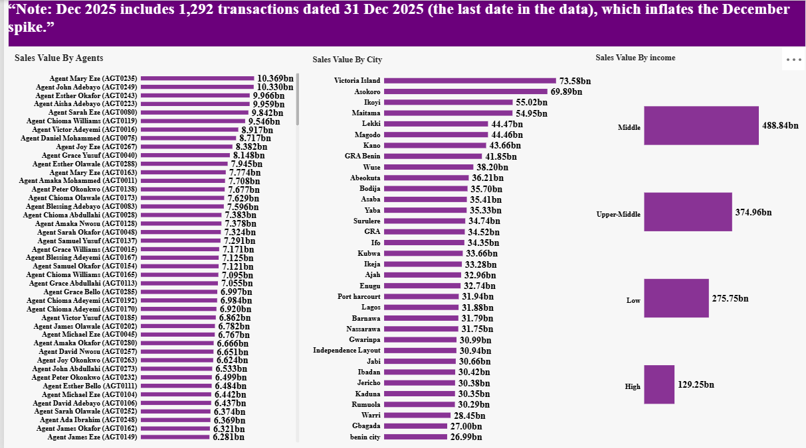

### Page 3: Specialization, Age, Gender

Sales value by agent specialization, and by customer age and gender.

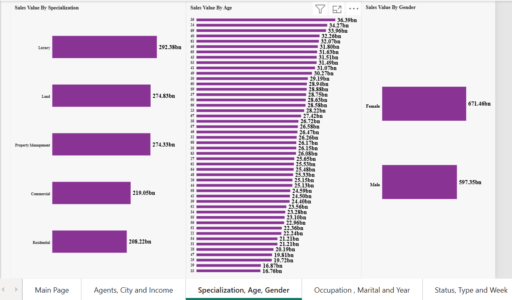

### Page 4: Occupation, Marital and Year

Sales value by customer occupation and marital status, and by quarter of the year.

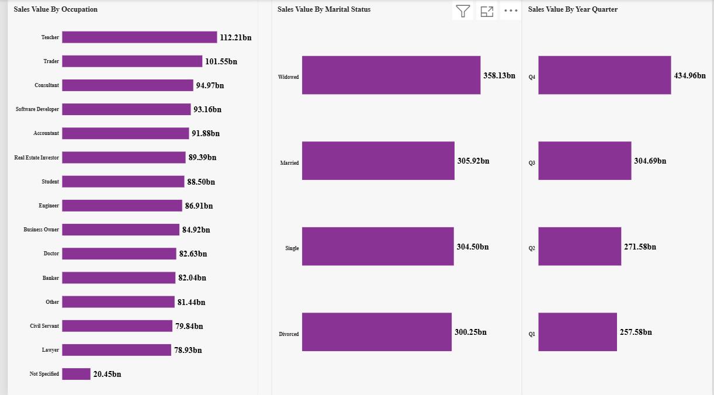

### Page 5: Status, Type and Week

Count of listings by status and by type, and sales value by furnishing status and by day of the week.

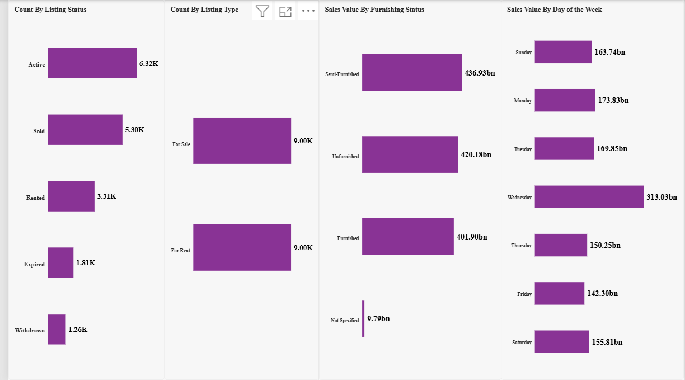

## 9. Interpretation and Communication

*Step 12: what the numbers mean, why they happened, and how they link back to the problem.*

1. **Value is concentrated in two states.** Lagos (about 413bn) and FCT (about 258bn) give 53% of all sales value. By region, South West leads with about 580bn (46%), then North Central (258bn), South South (229bn), North West (138bn) and South East (64bn).
2. **Premium neighbourhoods lead the cities.** Victoria Island (73.6bn), Asokoro (69.9bn), Ikoyi (55.0bn) and Maitama (55.0bn) are the top four cities.
3. **Apartments and Detached Houses make up half of the value.** Apartments bring about 396bn (31%) and Detached Houses about 239bn. Land (12bn) and Commercial Property (25.5bn) together are only about 3%.
4. **Sales carry the value; rentals carry the volume.** Sales are 94% of completed value (about 1.27T) and rentals 6% (about 75bn). By count they are almost equal (4,419 sales and 4,586 rentals) because the average sale is about 287 million naira against about 16 million for a rental.
5. **The market grew steadily through the year.** Quarterly sales value rises from about 258bn in Q1 to about 272bn in Q2 and about 305bn in Q3. The large Q4 bar (435bn) and the Wednesday peak (313bn) are caused by the 31 December 2025 cluster (see the data caveat below). Without it, Q4 is about 300bn and Wednesday about 178bn. Monday is the strongest day (174bn) and Friday the weakest (142bn).
6. **Sales are spread very evenly across the 300 agents.** The top five individual agents (Mary Eze, John Adebayo, Esther Okafor, Aisha Adebayo and Sarah Eze) each bring about 10bn, only about 4% of sales value in total. Agent specializations are balanced too, from Residential (208bn) to Luxury (292bn).
7. **Middle and upper-middle income customers bring most of the value.** Middle (489bn) and Upper-Middle (375bn) together give 68% of sales value. Low income brings 276bn and High income 129bn (10%).
8. **Gender, age, occupation and marital status are weak separators.** Female customers account for 671bn (53%) and male customers for 597bn (47%). No single age dominates. Occupations range from Teacher (112bn) to Lawyer (79bn), and marital statuses from 300bn to 358bn.
9. **Furnishing status makes little difference.** Semi-Furnished (437bn), Unfurnished (420bn) and Furnished (402bn) are close.
10. **Cancellations are the main risk.** About 1 in 4 transactions is cancelled, which put about 426bn of sale value at risk. Because the rate is almost the same in every state, property type and year, it points to the sales process, not to one place or product.

### Data caveat: 31 December 2025

1,292 transactions (10.8% of all) are dated 31 December 2025, the last date in the data. A normal day has about 7. About 135bn of completed sales fall on that one day. This inflates December, Q4, Wednesday and the 2025 totals. The most likely cause is dates clipped to the end of the data, because 71% of these transactions would have closed after that date. The data was left unchanged and the dashboard carries a note.

## 10. Actions and Recommendations

*Step 13: practical next steps for the business.*

1. **Concentrate on Lagos, FCT and the premium neighbourhoods.** Lagos and FCT give 53% of sales value, and Victoria Island, Asokoro, Ikoyi and Maitama lead the cities. Also investigate the South East (about 5% of value) to find out whether it is an untapped market or a gap in presence.
2. **Prioritise Apartments and Detached Houses.** They are half of sales value. Review whether Land and Commercial Property deserve the same effort, since they are about 3%.
3. **Treat sales as the revenue engine and rentals as a volume line.** The average rental is a small fraction of the average sale, so rental pricing and commission are worth reviewing.
4. **Target middle and upper-middle income customers.** They bring 68% of value. High income is only 10%, so it is either a niche or an opportunity for luxury offers. Gender, age, occupation and marital status are poor targeting criteria because value is spread evenly across them.
5. **Reduce cancellations, the biggest risk.** Each 1-point drop in the cancellation rate is worth roughly 17bn of sale value. Review the sales process (deposits, buyer qualification and follow-up), and start with the agents whose cancellation rates are highest.
6. **Lift the whole team and learn from the top agents.** Because sales do not depend on a few agents, gains will come from raising the team. Study what the best-performing agents do differently and share it.
7. **Fix date capture at the source.** Check the transactions dated 31 December 2025 with the owner of the data, so that trend analysis becomes reliable.

## 11. Documentation

*Step 14: method, assumptions and data sources.*

### Tools used

Power BI Desktop (Power Query for cleaning, Model view, DAX for measures and calculated columns, and report visuals), 7 CSV source files, Word and PDF for documentation, and GitHub for publishing.

### Facts

- "Sales value" means the value of completed sales only. Cancelled transactions and rentals are excluded from Total sale value.
- For rentals, transaction_amount is the annual rent.
- State, region and city come from the property's location.
- Month, quarter and day-of-week charts combine all five years (2021 to 2025).
- Agents are identified by agent_id, because agent names repeat.

### Limitations

- 31 December 2025 cluster: 1,292 transactions (about 135bn of completed sales) share one date, inflating December, Q4, Wednesday and 2025. The data was left as it is and a note was added to the dashboard.
- 121 properties (1.2%) have no size. They were left null and are excluded from price-per-sqm calculations.
- The price per sqm column mixes sale prices and annual rents. It is not shown on the current pages and, if used later, should be limited to sales.
- Blank values were replaced with "Not Specified": 80 in furnishing status and 100 in occupation.
- "Total customer" counts all customers on record, including those with no transaction.
- fact_listing and fact_transaction are not linked, so listing fields cannot filter transaction values. The listing charts use counts.
- Agent names repeat (300 agents share 184 names), so charts use a unique label combining name and ID.
- The cancellation rate and cancelled value were calculated from the raw data and are not shown as a chart.

## 12. Monitoring

*Step 15: tracking results and repeating the cycle when needed.*

To keep the dashboard current, replace or refresh the source files and click Refresh in Power BI. Review these KPIs regularly: total sale value, completed against cancelled transactions, and listings by status. After each refresh, check again for clusters of transactions on a single date. Rerun the full cycle if the business goals or the structure of the data change.
